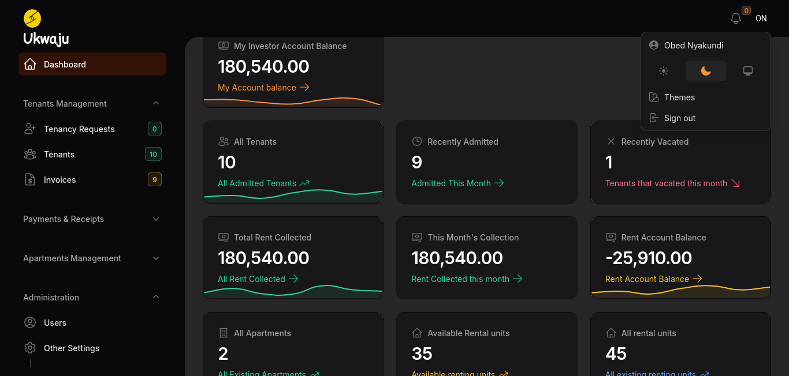

# East Rembo Rentals: Rental House Management System (Barangay East Rembo, Taguig City, PH)

This is a Philippine adaptation of the open-source *Rental House Management System* by Obed Nyakundi, focused on rentals in **Barangay East Rembo, Taguig City, Metro Manila (ZIP 1643)**.

## What was changed for East Rembo / the Philippines
- **Branding & content:** "East Rembo Rentals" name, landing-page copy, About page, footer address, contact-page map centred on East Rembo.
- **Currency:** all amounts are in Philippine pesos (PHP, ₱) instead of KES.
- **Phone numbers:** local `09XX XXX XXXX` numbers are saved as `+639XXXXXXXXX` (previously Kenyan `+254`).
- **Payments:** the M-Pesa field is now a *Reference No.* for GCash / Maya / bank transfers (the database column is still called `mpesaCode`, so existing data keeps working).
- **Tenant ID:** accepts alphanumeric IDs (PhilSys, UMID, driver's license, passport) instead of a Kenyan numeric ID.
- **SMS:** the Kenya-only TextSMS integration was replaced with an optional Semaphore (Philippines) integration. SMS stays off until you set a key.
- **Time zone:** the system now uses `Asia/Manila`.
- **Available Units page:** the public listing page now shows vacant units from the database (name, bedrooms, location, monthly rent in ₱).
- **Sample data:** East Rembo locations (Riverside, Tibagan, etc.), peso rents and Filipino sample tenants. **These are placeholders. Replace them with your real streets/puroks, units and tenants.**
- **Bug fixes:** several public forms pointed to a non-existent `Company_admin/` folder (now `admin/`), and the SMS function could not read its API key (now fixed).

## Things you MUST set before going live
1. `admin/functions/db.php`: database credentials, `$payment_instructions` (your GCash/Maya/bank details), and optionally `$sms_apiKey` / `$sms_senderName`.
2. Replace the placeholder phone `+63 9XX XXX XXXX` and email `info@eastrembo-rentals.example` in `index.php`, `about.php`, `contact.php`, `portfolio.php`, `blog.php`, `single.php` and `footer.php` with your real contact details.
3. Change the demo admin password (see below) and turn off `display_errors` in `db.php`.
4. Add your real locations in the admin panel (Houses > Locations) and your real units.

---

# Original project README (upstream)

# A web-based Rental House Management System
This is a web application for Rental House Management. It was originally designed for use in administrative reccords management in 2018, and was open to the public in 2020. The original version utilized SMS for communication and MPESA for payment.

Much has changed since its design to enhance its stability, security and performance. Not withstanding the changes, I believe that it still gives a solid foundation to anybody who is interested in learning the good old PHP and its application. It has instances for both imperative and OOP.

If you wish test the system, you can click the link below:

## [System Demo](https://test1.ukwaju.systems/admin/login.php)


# Original View


# Or the more stable Laravel version view...


developed under **[Ukwaju Systems](https://ukwaju.systems)** 
View a demonstration [here:](https://youtu.be/H1gM3E5sZPs)


# Included features
- a fancy landing page for display of vacant rooms/houses
- an administrator panel 
- a blog 
- a database

## Major Dependencies
**PHP Dependencies:**
- ~~fpdf~~ depricated. removed.
- ~~Africastalking~~ depricated. replaced with TextSMS
- ~~jGraph~~ depricated. removed.
- ~~php-Mpesa~~ depricated. replaced with daraja.

**CSS Dependencies**
- Bootstrap
- less
- Font awesome.
- W3.css

**JS dependencies**
- Bootstrap
- Hack
- jQuery navigation
- Fancy box
- Modernizer
- Ajax

# THE USER'S GUIDE
## HOW TO INSTALL:
 - Ensure you install XAMPP/WAMPP (or a relevant php host with MYSQL)
 - Create a table named `Company`
 - import the `Company.sql` file, from the `database` folder into your `PHPmyadmin` table `Company`
 - copy all the contents of folder containing the `index.php` file into your server.
 - open the file `admin/functions/db.pdf`
 - edit the details of the following to match your server connection details:
 ```
$host= 'YourHost';
$user='YourDatabaseUserName';
$usrpassword='YourDBPassword';
$database='YourDBName';

 ``` 
 - To enable sending SMS via the system, update the variables under:
 ```
$sms_apiKey = "YourAPIKey";
$sms_partnerID = "YourPartinerID";
$sms_shortcode = "TextSMS";
 ```
 - run the `index.php` file
 - run the `admin/` folder to login into the admin panel

## TO TEST:
Admin panel login credentials are:
 - USER NAME:  **obed@example.com**
 - PASSWORD:   **mimi**

## YouTube Link:
Watch the System **[illustration video](https://www.youtube.com/watch?v=uL3LVG_FmCc&t=1095s)** here: [https://www.youtube.com/watch?v=uL3LVG_FmCc&t=1095s](https://www.youtube.com/watch?v=uL3LVG_FmCc&t=1095s)


# License
This is the original app as was developed in 2018. A few changes have been made ever since its deployment to enhance its security, stability, and efficiency. Even then, we took care to retain the stability of this application. It's my hope that you will find this app fun to use and easy to improve. 

Feel free to use it as it will suit you. To receive a complete version of the software, please reach out to me via:

# Need further support?
Reach out for a stable version or support via:
Email: *paulnyaxx@gmail.com* or 
Tel:   *+254706748162*

# By me some coffee
You can offer support via 
1. M-Pesa:  **+254706748162** or 
2. Paypal: **harrysp254@gmail.com**


I wish you all the best as you explore this limited app!


# Views
## The Blog


## Admin Dashboard with notifications


## Table Sample (House Listing)


## Form Sample (Form for admitting a tenant)


# Mobile phone views
## Phone dashboard


## Phone form (admitting a tenant)


## Phone SMS notifications


# ...And With a New, Secure, Stable Version!
Our improved premium version is now out, developed in Laravel. It contains features for:

## General
- Adding apartments
- Adding rental units to apartments
- Admitting tenants to Rental units.
- Automated invoicing to tenats.
- Manual addition of payments (currently working on an android platform for unified automated payments)
- Printable payment receipts and invoices

## Administration
In the new version, the administrator can create custom roles for other users in the system. I.e, a landlord can create a role of a "caretaker" or "accountant" and assign appropriate roles.

## Marketing
We added
- Bulk SMS incorporated for marketing (utilizes TextSMS vendor at 0.3 KES per SMS text)
- A landing page that can display all vacant rooms with their pricing.
- Theme color changes for better visibility


# Special Thanks to:
- [Obed Nyakundi](https://github.com/ObedNyakundi)
- [Ukwaju Systems](https://ukwaju.systems/)